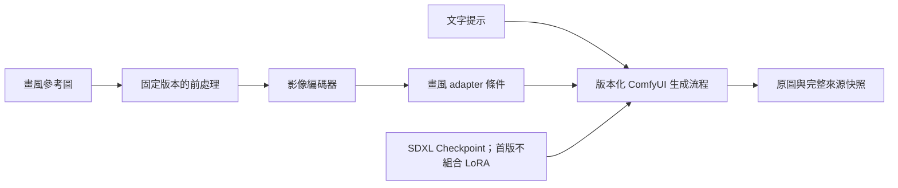

# 動漫畫風驗證與開發計畫

更新：2026-10-23。本文整理下一階段的實作順序、圖片準備、實驗及流程擴充邊界，供使用者與開發者共同依循。**本計畫與逐項驗收分開；R02 已接入單張參考流程，沒有交付通用動漫品質預設或訓練功能。** 完成狀態仍以 [ROADMAP](../ROADMAP.md) 及逐項驗收證據為準。

## 目標與目前能力

先區分三種需求，避免把上傳圖片、出圖成功或調整參數當成訓練完成。

| 目標 | 第一個方法 | 目前狀態 |
| --- | --- | --- |
| 一般動漫插畫 | 既有 Pony／Animagine checkpoint、提示詞及相容的畫風 LoRA | R05／L01 本輪有限比較完成；使用者已補圖，指定目標另見 R02 有限比較 |
| 參考特定畫風，生成不同人物／場景 | 參考圖影像編碼器及 style adapter | R02 已接入 SDXL Plus ViT-H 單張參考；用途標籤仍只是管理分類 |
| 長期使用可重複載入的專屬畫風 | 根據驗收結果決定是否訓練畫風 LoRA | T01 需求已完成；T02–T04 待評估及實作，目前沒有訓練服務 |

圖生圖把來源編碼成 latent，會連帶影響內容與構圖；Canny 提供邊緣結構，不能替代獨立畫風參考。R04 的椅子與兩種 LoRA 實測驗證了限定整合及還原，沒有證明動漫畫風、角色一致或材質品質已通過。見 [目前流程](models/reference-workflows.md)、[R04 結果](validation/pony-canny-v2-20261023.md)。

## 本輪與後續開發順序

此順序以「動漫畫風驗證」為目標，不取消其他階段的前置條件。R05 的 18 件有限基準及 L01 的 14 組原生／4 組拒絕載入證據已完成，狀態按各自驗收更新；R02 已使用指定圖片分開比較畫風與角色，保留偏差；後續順序依使用者指定為 **T01 → T02 → R01 → R03**，不自動開始 T03 訓練。

| 順序 | 項目 | 本輪應交付的內容 | 繼續下一步的依據 |
| --- | --- | --- | --- |
| 1 | [R05：更多模型、seed、素材與提示格式](../CHANGELOG.md#r05) | 動漫測試題材、固定提示／seed、兩模型基準、原圖與人工品質觀察 | 能指出現有模型缺少的是畫風、內容服從、構圖或角色一致性 |
| 2 | [L01：更多 LoRA 組合與畫風品質](../CHANGELOG.md#l01) | 先單一畫風 LoRA，再按需比較強度及排列；保留來源／版本／hash | 分開記錄載入相容性、畫風效果及內容偏移，不以 LCM 加速代替畫風品質 |
| 3 | [R02：畫風與角色參考 adapter](../CHANGELOG.md#r02) | 先完成單張畫風參考的版本化流程、元件登記、實機生成及完整還原 | 比較無參考與有參考的差異，檢查是否混入參考角色／構圖；角色跨場景另驗 |
| 4 | [T01：確認實際訓練需求](../CHANGELOG.md#t01) | 根據前三項結果決定是否需要訓練，明定基底、用途與驗收目標 | 推論調參、既有 LoRA 或 adapter 仍無法滿足已寫明的需求時，再進入訓練 |
| 5 | [T02：資料集、標註及版本](../CHANGELOG.md#t02) | 每種畫風獨立分組、內容標註、去重、來源紀錄及固定評估集 | 資料可追溯、可重建，且評估圖沒有混入訓練資料 |
| 6 | [R01：pose／depth 結構參考](../CHANGELOG.md#r01) | 逐種核對控制模型、前處理與完整保存還原 | 指定姿勢／構圖與角色身份分開驗收 |
| 7 | [R03：專用修補模型與品質](../CHANGELOG.md#r03) | 比較接縫、羽化、遮罩外保留及失敗 | 不以完成生成代替修補品質 |

圖片收集與評估分組可以從 R05 就開始；T02 是把訓練資料契約與工具整合正式化。真正啟動訓練前仍需 T03 的獨立環境與 GPU 協調；訓練產物再依 T04 回登及評估。完成需求及資料準備不等於訓練服務已可使用。

<a id="image-input-reminders"></a>

## 實作時提醒使用者提供圖片

**後續實作進入需要真實圖片的步驟時，先核對已提供的資料；缺少或不足以涵蓋本輪目標時，主動提醒使用者。** 這是實作過程的提醒約定，不是現在就要求備齊所有圖片。已收到且適用的資料應沿用，不因換開發項目而重複索取。

| 何時提醒 | 需要使用者提供／確認的內容 | 圖片尚未提供時可先做什麼 |
| --- | --- | --- |
| R05：開始指定作者／畫風的品質比對前 | 作者／畫風分組、目標特徵及原圖。建議三組各十張、每組七張候選參考與三張保留評估；先驗一組也可以 | 實作比較入口、固定題材及無參考模型基準；不宣稱已完成該作者畫風驗收 |
| L01：比較新畫風 LoRA 前 | 優先沿用 R05 已確認的目標圖；只有換畫風或樣本不足時才提醒補圖 | LoRA 相容性、完整設定及保存還原測試；品質結論保持待驗收 |
| R02-01：首次真實畫風參考驗收前 | 已確認的候選參考圖與獨立保留評估圖，先選本次實際輸入的一張；多作者測試依分組逐次進行 | 元件選型、schema、預檢、workflow、錯誤及恢復測試；不以合成測試圖代替作者畫風證據 |
| R02-02：開始同一角色跨場景驗收前 | 另確認目標角色，提供該角色不同視角／姿勢／場景的圖片與保留圖；數量依角色驗收方案另定 | 角色流程設計及技術測試；不能把同作者筆下不同角色的圖片當成身份一致證據 |
| T01 決定試訓後、T02／T03 開始實際訓練前 | 每種畫風的獨立資料集、內容標註及分割。起步可用 20–50 張訓練圖，另留 5–10 張評估圖；重新確認哪些既有圖片可沿用 | 需求決策、資料契約、工具與環境評估；未決定訓練時不預先要求完整訓練集 |
| T04：訓練產物的最終品質驗收前 | 核對保留集是否曾用於訓練或反覆調參；若已用過，提醒提供新的獨立評估圖 | 產物 hash、回登及載入驗證；不以已用過的圖片宣稱泛化品質通過 |

提醒時一次說清楚本次用途、作者／畫風或角色、建議張數、需要的內容變化，以及哪些圖片只作保留評估。請使用者提供圖片附件或本機資料夾位置，並附來源及目標特徵；張數是起步建議，不當成所有技術工作的硬性阻擋條件。

可使用以下提醒範例，依實際缺少的資料調整，不重複要求已提供部分：

> 接下來要驗證 R02 的真實畫風參考，需要你確認目標作者／畫風及圖片位置。若尚未提供，可先準備一組十張，其中七張作候選參考、三張保留評估；要測不同畫風時再擴充成三組。請一起說明最在意的線條、配色或陰影特徵。我會先沿用已收到且適用的圖片，只提醒補齊缺少部分。

目前本計畫的資料登記如下；實際收到資料後再更新位置、數量、版本及分割，不能只因寫好文件就標成已收到或已驗收。

| 資料 | 目前登記狀態 | 下次核對時點 |
| --- | --- | --- |
| 作者／畫風參考與保留評估圖 | 2026-10-23 已收到 `artist_ref/ハシスタジオ_pixiv`；22 檔、20 個不同檔案內容；`hashi-reference-20261023-v1` 凍結分組，另留 6 張評估 | 先沿用本批；換畫風或進入訓練資料整理才核對是否補圖 |
| 同一角色的參考與評估圖 | 使用者已確認棕色長髮、綠眼、綠色髮飾角色；已選 1 張角色圖，獨立保留圖供跨場景人工比對，正式名稱未確認 | 不將同作者其他角色混作同一身份；T01／T02 再確認訓練視角與 caption |
| 畫風 LoRA 訓練集與獨立評估集 | 尚未決定訓練，不預先要求備齊 | T01 決定試訓後 |

**本輪 R02 是推論時單張參考，不是訓練。** 目前實際只選 1 張畫風圖、1 張角色圖分開生成，每次輸入其中一張；候選圖不會全部自動匯入，保留評估圖不作輸入或調參。原圖未改寫，沒有訓練 LoRA 或更新 checkpoint 權重。完整檔名、分割及凍結清單 hash 見 [R02 圖片用途紀錄](validation/reference-inputs-20261023.md)。

收到後依下節記錄原檔、來源、hash 與資料分割，不把原圖加入 Git。等待圖片期間繼續不依賴這批圖片的開發，明確列出哪些品質驗收仍待使用者資料；不得自行下載替代圖片後把使用者目標視為已驗證。

## 圖片怎麼準備

### 第一輪畫風驗證

只想驗證一種畫風，**一位作者／一組畫風即可開始**。要比較系統面對不同畫風的表現，建議起步為 **三位畫風差異明顯的作者，每位十張，共三十張**。作者名稱是分組與目標描述，不能保證模型認得該名字，也不會因此自動學會畫風。

起始建議每組十張分成七張候選參考及三張保留評估圖；實際收到的本批依圖片用途紀錄分組。R02 每次只用一張候選參考，七張不是每次必須一起輸入。多參考融合需另定有序輸入、權重及驗收，不能因收集多張就宣稱已支援。

- 同組先選定一致的畫風時期與媒材，避免把作者不同時期的差異混成一個目標。
- 涵蓋不同角色、近景／半身／全身、姿勢與背景；不要全部是同一角色或幾乎相同構圖。
- 記錄想比較的線條、眼睛／臉部造型、配色、陰影、材質及背景處理；角色身份與畫風分開描述。
- 優先使用清晰原檔；短邊約 768–1024 像素可作收集目標，不是品質保證或硬性門檻，不為湊尺寸而放大模糊圖。平台目前單張素材上限為 20 MiB、1600 萬像素。
- 保存原圖、來源及可取得的使用條件。平台上傳會正規化及移除 metadata，不保存上傳前原檔，原檔須另外保留。

保留評估圖不作 adapter 輸入或訓練圖，也不拿來反覆挑選參考權重；同一原作的裁切、縮圖或近似重複檔應視為同一來源分組，不能跨到參考與評估兩邊。若用完保留集後繼續調參，另設新的最終評估集。

### 確定需要訓練時

每種畫風可先用 **20–50 張訓練圖，另外保留 5–10 張評估圖** 作小規模試訓起點。這些張數與前述三十張都是本專案的工程起始配額，**不是官方最低要求，也不保證收斂或品質**；是否補圖依目標涵蓋、重複程度、過擬合及新題材的表現判斷。

第一輪每種畫風分開訓練及評估，不直接把三位作者混成同一個 LoRA。標註分開記錄「畫面有什麼」與「目標畫風是什麼」，避免固定人物、服裝或背景成為畫風的替代訊號。評估圖應為不同原作，不能以同圖裁切充數。訓練環境、工具、參數及實際顯存需求尚待 T01–T03 決定。

### 資料與檔案紀錄

原圖及試驗產物可先放在已忽略的 `runtime/style-study/<study-id>/`，自行備份；不把原圖或權重隨文件提交 Git。下面保留研究資料整理建議；T02 的正式本機訓練清單與出口已另見 [資料契約／CLI](training/dataset-contract.md)，兩者都不是生成 API schema：

```text
runtime/style-study/<study-id>/
  originals/<style-group>/       原檔，保持不變
  manifests/                    分組、版本、來源與分割紀錄
  captions/                     內容標註與風格描述
  reports/                      方案、任務／作品 ID、人工觀察與量測
```

| 紀錄 | 最少應保存的內容 |
| --- | --- |
| 研究／分組 | study ID、資料版本、作者／畫風組 ID、目標畫風描述及與本輪無關的變因 |
| 每張原圖 | 原檔名、相對路徑、原始 SHA256、尺寸、來源／原作 ID、來源連結、可取得的使用條件 |
| 圖片關係 | 參考／訓練／保留評估用途、原作或近似重複群組；內容 caption 與風格描述分開 |
| 平台素材 | 上傳後 asset ID、正規化 SHA256、前處理版本；與原檔 SHA256 分開，不以檔名互換 |
| 實驗結果 | 原模型／元件版本與 hash、完整設定、提示詞／字串 seed、方案／任務／作品 ID、原圖／workflow hash、人工觀察 |

study ID 與資料分割先作研究紀錄；目前沒有這些專用 API 欄位，不直接塞入現有生成 body 或 experiment_context。R02 已定義單張推論 schema 與快照；T02 已另定訓練資料集的正式 [schema／驗證與保存位置](training/dataset-contract.md)，不向既有生成請求添加訓練欄位。

## R02 後的指定優先順序

使用者於 2026-10-23 指定 R02 後續固定為 **T01 → T02 → R01 → R03**：

| 順序 | 範圍與交付 | 進入下一項前應保留的依據 |
| --- | --- | --- |
| T01 | 根據 R02 的畫風污染、角色衣著帶入及場景偏差，決定畫風 LoRA、角色 LoRA 是否需要分開；定義目標架構、資源與驗收範圍 | 需求決策不等於已訓練；先明確人物外觀、畫風、提示服從各自的標準 |
| T02 | 定義資料清單、原作群組／去重、角色辨識、內容 caption、畫風描述、來源／使用條件、版本與固定評估集，評估工具介面 | 不把本批 20 個不同內容全當同一角色；沿用既有圖片，只有缺少必要視角或分組時提醒補圖 |
| R01 | 逐種加入 pose／depth 等結構控制，處理指定姿勢與構圖 | 不以 pose 控制代替角色身份或畫風訓練；每個模型／前處理另驗 |
| R03 | 專用 inpainting 模型與更多羽化、接縫／邊界品質比較 | 不以能生成代替遮罩外保留或修補品質；保存失敗樣本 |

T01／T02 已完成需求與資料介面。T02 唯讀盤點 22 檔，分為 10 張候選、6 張開發評估、6 張排除；兩路徑 caption／來源用途及角色身分仍待逐張審查，並無未曝光 final test，見 [缺項與驗收](validation/training-dataset-20261023.md)。試訓前才提醒審查或補齊必要圖片，T04 前另確認最終評估圖。

本輪不因完成 T01／T02 就自動執行 T03 訓練；訓練環境、GPU 協調與產物回登依原 ROADMAP 另行決定。

## R05 第一批可執行的比較

先選三個固定題材：人物近景、全身人物與服裝、人物加背景場景。每個題材先寫好內容提示詞及判斷要點，選兩個精確 seed，對 Pony／Animagine 建立基準；模型、來源與未知欄位依現有登記如實保存。

第一批為 **兩個 checkpoint × 三個題材 × 兩個 seed，共十二次明確生成**。可以沿用 R06：每個題材／seed 建立一份 checkpoint 軸比較方案，每份兩組，共六份；選「目前提示詞」，保留同一組的負面提示詞、尺寸、取樣及空 LoRA。每份仍低於八組上限，逐組載入與手動生成；資料集的三位作者先作人工目標比對，不在基準階段擴成三十六個隱藏任務。

這輪先固定共同提示格式及參數，再另開方案比較模型作者建議的提示格式，避免同時換模型、提示與 seed 後無法解釋差異。不同模型最佳參數另作條件紀錄，不把共同條件測試當成全面模型排名。

L01 接續先測一個適用於選定 checkpoint 的畫風 LoRA，固定其餘條件比較少量強度；需要時再比較排列。LCM 類加速方案的 steps／CFG／sampler 與畫風方案分開記錄，不能把少步數成功當成畫風改善。每次擴充先列出預計次數，保持有限且明確操作。

R05 已新增獨立的 `anime-illustration-v1.json`：版本／bytes hash、UI 測試集選單、API `suite_id` 與單組 `scripts.verify_anime_suite` 入口均獨立保留；不覆寫通用 v1 的舊四案例或歷史 hash。新正向／反向提示詞軸可逐項比較完整文字，未自動導入作者圖片或建立生成批次。現有能力與限制見 [比較方案](experiment-plans.md)、[結果關聯](experiment-plans.md#runs-and-artworks)、[固定測試集](illustration-suite.md)。

## 不重寫整體架構，新增參考圖流程

Vue、FastAPI、SQLite 與獨立 ComfyUI 保留。R02 選用固定版本 IP-Adapter Plus SDXL ViT-H、ViT-H/14 編碼器與 ComfyUI_IPAdapter_plus，於推論提供條件，沒有用這批圖片訓練。實機範圍限定 Animagine，Pony 及其他組合未由此推定；安裝、版本與嚴格流程見 [R02 操作](models/ipadapter-reference.md)。



| 層次 | R02 需新增或擴充的責任 |
| --- | --- |
| 能力／元件 | 核對匹配的 checkpoint、影像編碼器、adapter 及節點介面；保存固定來源、版本、SHA256、架構與使用條件，不能依檔名推定相容 |
| 設定／workflow | 獨立的版本化流程、嚴格輸入 schema 及完整 builder；先單張畫風參考，強度／作用範圍按實際節點能力定義，不借用 denoise 或 Canny 強度 |
| 素材與快照 | 凍結原素材、縮放／裁切／正規化方式、衍生輸入及 hash；記錄實際參考權重與模型／元件快照 |
| 提交／恢復 | 沿用原引擎、持久 UUID、預檢、單次提交及原版本 pending；未知結果只確認，不自動重送或換新版本 |
| UI／還原 | 明確區分畫風參考、角色參考、圖生圖及 Canny；提供強度、缺元件／未知狀態、來源與完整設定還原，載入不生成 |
| 交換／比較 | 另定無損專用格式與能力；未完成前明確拒絕一般草稿／交換／比較入口，仍保留完整 workflow 下載，不丟棄 adapter 欄位 |

可參考現有 [架構與資料流](architecture.md)、[原始來源／前處理流程](models/reference-workflows.md) 及 [R07 專用格式邊界](specialized-workflow-formats.md)。R06 的一般比較不會自動支援新 adapter 工作流程，新增強度欄位也不等於保存、交換與還原全數可用。

先驗證 R02-01 的畫風參考，再另驗 R02-02 的同一角色跨場景外觀；只完成畫風流程不能關閉整個 R02。多參考融合、畫風加 Canny、畫風加角色參考也各自另驗，不能直接借用單張畫風結果。

## 每輪驗收與訓練決策

| 驗收面向 | 應留下的證據 |
| --- | --- |
| 載入相容性 | 權重／元件身分、節點介面、實際載入與失敗日誌；同步清單或成功出圖不代替品質評估 |
| 品質 | 人工並排原參考、保留評估圖及新生成作品；觀察線條、造型、配色／陰影、提示服從、構圖及參考內容混入，保留失敗原圖 |
| 評分 | 沿用 prompt_adherence、character_consistency、visual_style、composition 四項人工評分，其餘特徵寫筆記；未測的角色一致性保持未評分，不自動計分 |
| 保存／還原 | 原圖／完整 workflow／所有來源與版本、精確 seed、LoRA 順序及新 adapter 參數；原引擎離線與平台重啟後可讀，缺來源時明確拒絕部分還原 |
| UI／錯誤 | 桌面與 390px 操作、真實下載／載入、缺元件、登記或來源變更、未知回應及原 UUID 恢復；沒有未要求的生成 |
| 資源 | 固定硬體、環境、尺寸與條件，區分冷載入／快取、平台／引擎耗時及整卡取樣；adapter 與訓練各自重測，不沿用既有 RTX 3060 推論數字保證可用 |

畫風相似、角色一致、構圖接近是不同目標；不能用逐像素相似度或複製原構圖代替畫風成功。既有四項評分的定義及每輪判斷要點先固定，避免看完圖片後才變更標準。

T01 已根據 R05／L01／R02 決定規劃獨立的畫風／角色 SDXL UNet LoRA 候選，先畫風、再角色；基底、排除範圍、兩路徑各 12 件未來比較及四面向判準見 [需求 v1](training/requirements.md)。需求完成不等於 trainer 相容、資料就緒或已訓練。若選訓練，先完成資料契約與獨立環境／GPU 協調，再記錄基底、工具／版本、資料分割、caption、參數及產物 hash。T04 回登後，重新使用未參與訓練與調參的保留集評估；不因訓練完成就宣稱品質通過。

## 方法來源

以下是方案評估的官方資料入口，於 2026-10-23 查閱；不能替代本專案的節點選型與 GPU 驗收。

- [Diffusers IP-Adapter](https://huggingface.co/docs/diffusers/using-diffusers/ip_adapter)：影像編碼器及參考圖條件，可保留文字提示並調整影像影響程度；本專案仍使用 ComfyUI，不因此新增 Diffusers 推論服務。
- [InstantStyle 官方專案](https://github.com/instantX-research/InstantStyle)：畫風／內容分離的候選方法；尚未指定為本專案實作。
- [Diffusers LoRA 訓練](https://huggingface.co/docs/diffusers/training/lora)：訓練少量新增權重的方式；本文圖片張數是專案起步建議，不是此文件規定的最低要求。
