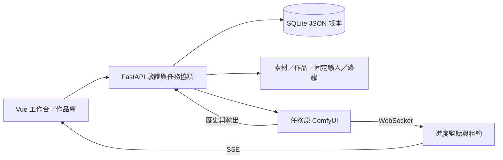

# 架構與資料流

目前為本機單人工作台：Vue 編輯與顯示，FastAPI 驗證、保存及通訊，獨立 ComfyUI 推論。SQLite 與本地檔案共同構成可恢復資料。`backend.main.create_app` 為每個 app 建立獨立 AppContext，功能模組的 `install(app, host)` 接收該 context；匯入不建立使用者資料，初始化在 ASGI lifespan。配置介面與隔離方式見[應用程式工廠](#application-factory)。



## 模組責任

| 位置 | 責任 |
| --- | --- |
| frontend/src/App.vue | 導覽、平台／引擎資訊、KeepAlive 工作台 |
| 各 Studio、GenerationPanel、jobEvents.ts | 專用表單、提交／恢復、任務與進度 |
| TrainingWorkspace、training_review、training_control | 人工圖片審查、不可變修訂、持久準備 UUID／單次啟動標記與狀態查閱；沿用獨立 training_runs／training_artifacts，不在平台載入 Torch |
| backend/main.py、app_context.py | app 工廠、明確配置、啟動時初始化與引擎 HTTP 介面 |
| core_api.py、schemas.py、各 install 函式 | 每 app 的端點／鎖、純請求型別與功能註冊 |
| submissions、flux_workflows、專用 *_api | 完整流程／來源驗證、輸入上傳與明確提交 |
| jobs、cancellation、stopping、progress | UUID 帳本、修訂、取消／停止、租約與歷史核對 |
| catalog、loras、flux_catalog、control_catalog | 引擎範圍清單及登記版本／來源 |
| template_context、models/simple-creation-templates-v1.json／simple-creation-extra-templates-v1.json／simple-style-templates-v1.json | 原三份、新增十二份及兩個畫風任務；伺服器計算修改欄位並保存不可變模板來源 |
| gallery、assets、experiment_store 等 | 本地資料、整理修訂與引用 |
| workflow_support、WorkflowFormatSupport | 專用版本的草稿／交換／比較能力，拒絕部分轉換；平台格式描述與引擎即時能力分開 |
| runtime_metadata、execution_device、job_measurements、resource_sampling | 提交前環境／裝置觀察；原引擎有界背景取樣使用獨立 journal，終態凍結，任務專用峰值保持未知 |

模板、來源相容與 CPU 預覽各有模組；不接受任意第三方節點圖，各專用流程需要完整模板與能力檢查。

<a id="application-factory"></a>

## 應用程式工廠與配置

`backend.main.create_app` 保留 `backend.main:app` 啟動入口與所有 URL。匯入模組、建立 app 與註冊路由不建立 DATA／SQLite；ASGI lifespan 啟動才建立必要目錄與 `settings` 表。既有 JSON 不需遷移或回填。

```python
from backend.main import create_app
from fastapi.testclient import TestClient

app = create_app(data_root="runtime/my-isolated-data")
with TestClient(app) as client:  # 執行啟動與關閉生命週期
    assert client.get("/api/health").json() == {"status": "ok"}
```

| 參數 | 預設／責任 |
| --- | --- |
| root | 專案根目錄，決定受管理 ComfyUI、固定來源及前端 dist 的位置 |
| data_root | root/data，決定素材、作品、job_inputs、control_edges 等保存位置 |
| database | data_root/atelier.sqlite3，可指定既有資料庫；若分離至其他目錄，備份須另包含該檔 |
| engine_client_factory | 預設建立 httpx.AsyncClient；可注入相同 async context manager 介面的實作，接收原 timeout／trust_env／follow_redirects 參數 |

AppContext 位於 `app.state.context`，各 app 的路徑、引擎網址讀取、環境快取、路由鎖與進度 Hub 均獨立。功能模組依原有順序逐項註冊，不再讀取整個 main 模組；純請求型別在 schemas.py，舊的 main.DraftInput 等純型別匯出保留。一般產品程式透過工廠與 HTTP 使用，不需修改 context 內部欄位。

引擎 HTTP 使用 context.http_client；預檢及後續查詢仍使用任務保存的原網址，取消、停止與原 UUID 恢復規則不變。WebSocket 仍由每 app 的進度 Hub 依原 client ID 連線；沒有將裝置快照當全域提交許可。

測試透過工廠建立臨時資料，不 patch `main.DB／DATA／ROOT`。在同一 TestClient 回呼模擬另一請求的測試，可先明確執行自身 `context.initialize` 再建立短生命週期 TestClient，避免同一 portal 執行緒重入；正常服務仍由 lifespan 初始化。回歸核對兩 app 的設定、相同 UUID／不同原引擎任務、素材、環境快取及 client 互不混用，import 不建立資料，重開 app 保留原 JSON 與精確 seed。

```powershell
.\.venv\Scripts\python.exe -m unittest backend.test_app_factory
.\.venv\Scripts\python.exe -m unittest discover -s backend -p 'test_*.py'
```

回退程式前先停止原服務；此工廠改造未變更 SQLite schema、資料 key 或圖片布局，不需轉換資料，不在運作中的同一資料上混用不同版本。

## 任務與原引擎

新 UUID 先交易保存 validating，凍結 workflow、精確 seed、模型／元件／素材／實驗關聯；舊 UUID 核對相同請求後返回，不重新提交。

主路徑為 `validating → uploading_input（有參考圖時）→ submitting → queued → running → completed／failed`。遺失提交回應為 unknown，只查詢原請求；百分比不是終態證據。取消使用 cancelling／cancel_unknown，確認後 cancelled；停止使用 stopping／stop_unknown，確認後 stopped，也可能經歷史確定 completed／failed。修訂號避免舊觀察覆寫新結果。

任務保存 engine_url 與 prompt／client ID，設定頁改引擎不移動舊任務。作品匯入讀取原引擎記錄的輸出。SSE 送摘要，上游 WebSocket 共用並以 SQLite 租約保護；二進位預覽不當作作品。快照與限制見 [版本](runtime-versions.md)、[裝置](execution-device.md)。

<a id="submission-invariants"></a>

## 提交、恢復與終態維護邊界

| 狀態／操作 | 維護邊界 |
| --- | --- |
| 未送出表單 | 可編輯不代表已保存；先凍結完整參數、UUID、流程版本及原端點，成功保存 pending 後才可發出 POST |
| 提交結果未知 | 網路／不完整 JSON／無法確認的 5xx 不能清除原 pending；恢復使用原凍結內容，不讀目前表單，不另產生 UUID 或自動重試 |
| 已有任務 | 同 UUID 先核對既有圖／來源／實驗設定再返回；不能用新引擎、新元件或新版本重跑舊 UUID |
| 取消／停止確認中 | cancelling／cancel_unknown 與 stopping／stop_unknown 只確認原操作，不把查詢變成新的取消／停止 POST，不使用全域 interrupt |
| 終態 | completed／failed／cancelled／stopped 依原引擎歷史與擁有權確認；節點進度或佇列消失不能代替終態證據 |
| 修訂與過期觀察 | compare_update 核對取得觀察時的 revision；過期觀察不得覆蓋新狀態。busy 在 finally 清除，過期查詢不得改寫已離開／重新啟用的畫面 |

條件複雜時用具名函式或具名判斷說明上述操作；不要把不同 workflow 的 schema、來源 hash、遮罩／邊緣驗證或專用版本合併成較寬鬆的通用提交器。公開 JSON、精確 seed 字串、localStorage key、來源快照及原始 bytes 下載均屬相容契約。

起始模板來源為選填的 `template_selection`（固定 ID／版本），不接受客戶端自填驗收文字。`jobs.reserve` 在新 UUID 交易中凍結由 `template_context` 解析的原配方、元件要求、證據文件、配方 SHA256 及實際修改欄位，與 workflow／模型快照同時保存。來源也納入同 UUID 一致性比對；原任務恢復先返回舊紀錄，不重新解析目前配方。任務更新不能覆寫 `template_context`，作品保存複製原快照。這是 JSON 的選填擴充，不需 SQLite 遷移，也不回填舊任務或作品。

簡易模式維持三個模型入口，各含五份配方，另有兩個畫風任務；全部共用 GenerationPanel／既有提交及素材保存服務。LoRA 模板核對固定基底與單一原生 LoRA 的 SHA256／架構及雙強度。參考模板固定 SDXL Plus ViT-H 組合，僅走 adapter API；參考素材 ID 是可變輸入，不寫入靜態 baseline，其不可變素材及預處理快照仍隨 job／artwork 保存。新增登錄檔與範例索引不改原三份 digest。ReferenceStudio 的簡易轉交及任務還原保留來源，但沒有擴大專用流程的草稿／交換格式。

配方內容以版本識別；變更已發佈配方時應新增版本及對應解析支援，不沿用舊版本改寫內容。Checkpoint 取樣參數目前沿用 profile，配方摘要亦涵蓋解析後參數；若 profile 改變造成起始配方變化，也需更新模板版本。歷史快照永遠讀原紀錄，不以現在的登記或證據文件取代。前端來源顯示、進階草稿與設定還原保留 ID／版本，重新生成建立新快照，不能把起始來源當作品質驗收。

格式、狀態重構與功能差異應分開提交。格式整理須核對 Python AST、TypeScript／Vue 編譯結果及 CSS 值，再跑既有行為回歸；狀態重構另核對原 UUID、原端點、保存失敗、未知結果、revision 與終態。格式檢查不代表 GPU、UI 或品質驗收；工具與範圍見[品質檢查](quality-checks.md#static-checks)，歷史語意比對及錯誤探針見 [Q10 紀錄](validation/maintenance-20261023.md)。

## 資料位置與約束

| 位置 | 內容 |
| --- | --- |
| data/atelier.sqlite3 | settings key/value JSON：設定、登記、草稿、任務、作品、素材、比較方案 |
| data/assets | 正規化 PNG，來源 hash／處理版本在紀錄內 |
| data/artworks | 原始圖片與縮圖；workflow／版本快照在 SQLite |
| data/job_inputs | 提交時固定的預處理圖／遮罩，不能用新處理取代歷史 |
| data/control_edges | 明確匯入的原條件圖，與作品分開 |
| data/structure_outputs | pose／depth v3 同次實際條件圖；與 SQLite structure_output:* 一起備份 |
| runtime/ComfyUI | 獨立引擎、權重、input／output，不納入 Git |
| data/training_bundles | T05 明確匯出的 train PNG／caption、清單與封存；原圖不搬入，審查修訂及出口 UUID 在 SQLite |
| runtime 下隔離 DATA／報告 | 驗收原始證據，保存範圍依各紀錄 |
| models/*.json、experiments/*.json、docs/validation | 固定 manifest、案例集及可追溯驗收文字，納入 Git |

seed 在表單／設定交換為字串；原始 workflow 大整數不經 JavaScript number 重新序列化下載。提交快照不可變，舊紀錄缺欄位不由目前環境回填。收藏／筆記／評分／封存等可變資訊採修訂號。

備份須包含 SQLite 與對應檔案，見 [操作指南](setup-and-operations.md#備份與還原)。平台與引擎硬體分屬不同來源；資源快照、平台時間與 GPU 峰值不互相替代。

清單使用每 app 的有限 key 快取與 SQLite 摘要投影，固定成員後逐頁讀取最新內容；舊 JSON 不遷移、圖片只檢查本頁。新舊 API、程序限制與量測見 [清單分頁](list-pagination.md)。

<a id="storage-capacity"></a>

## 系統資訊目錄與磁碟容量

`GET /api/storage` 提供唯讀目錄／磁碟快照、固定目錄 ID、Windows 開啟能力與逐目錄 `can_open`。同一實體磁碟區只計算一次；總量、可用量與使用比例描述整個磁碟區，不是資料夾遞迴大小。更新失敗保留上次快照並標示失敗；未知容量不當成零。模型／作品分類容量尚未實作，不能用磁碟已用量或預覽比例補造分類統計，見[獨立能力待辦](ui-redesign/BACKEND-CAPABILITIES-BACKLOG.md)。

目錄圖示支援鍵盤及至少 44px 點擊範圍，開啟的是平台主機的本機目錄，須從該主機的 `127.0.0.1`／`localhost` 頁面使用。未建立、不可讀目錄及非 Windows 平台停用；不因點擊建立目錄或改開父目錄。容量未知但目錄可讀時仍可開啟。額外 checkpoint ID 由保存的完整路徑雜湊建立，排序變更不會把舊按鈕指向別處。

`POST /api/storage/open-directory` 僅接受 JSON `directory_id` 與快照 `expected_path`。後端重新從固定／已登記清單找目標，核對既有可讀本機目錄及實際位置；不接受任意檔案或路徑。路徑移除或變更須先更新快照；只接受本機連線、loopback Host 與相同來源，拒絕網路／UNC 位置，最後以 Windows `os.startfile` 開啟，不組合 shell 命令。

等待期間停用重複操作，失敗顯示訊息且不自動重試。成功僅表示檔案總管接受要求，不能確認使用者已看見視窗。操作不讀模型內容、不提交生成、不修改資料庫。更新後須重啟後端；仍為舊版時介面保留目錄並提示重啟，不能誤判為主機不支援。

原目錄／模型路徑、長路徑、遺失目錄、舊快照、鍵盤、失敗不重試與真實 Windows 開啟的限定驗收見 [2026-10-24 紀錄](validation/storage-overview-20261024.md)。測試截圖的固定容量僅示範布局。
