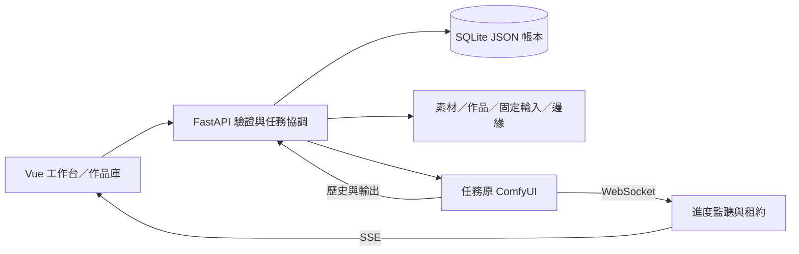

# 架構與資料流

目前為本機單人工作台：Vue 編輯與顯示，FastAPI 驗證、保存及通訊，獨立 ComfyUI 推論。SQLite 與本地檔案共同構成可恢復資料。現行組裝仍透過 main.py 與 `install(app, host)`；顯式配置重構見 Q02。

## 模組責任

| 位置 | 責任 |
| --- | --- |
| frontend/src/App.vue | 導覽、平台／引擎資訊、KeepAlive 工作台 |
| 四種 Studio、GenerationPanel、jobEvents.ts | 專用表單、提交／恢復、任務與進度 |
| backend/main.py、各 install 函式 | 設定／草稿／素材端點及功能組裝 |
| submissions、flux_workflows、專用 *_api | 完整流程／來源驗證、輸入上傳與明確提交 |
| jobs、cancellation、stopping、progress | UUID 帳本、修訂、取消／停止、租約與歷史核對 |
| catalog、loras、flux_catalog、control_catalog | 引擎範圍清單及登記版本／來源 |
| gallery、assets、experiment_store 等 | 本地資料、整理修訂與引用 |
| runtime_metadata、execution_device、job_measurements | 提交前環境／裝置／資源觀察，未知保持未知 |

模板、來源相容與 CPU 預覽各有模組；不接受任意第三方節點圖，各專用流程需要完整模板與能力檢查。

## 任務與原引擎

新 UUID 先交易保存 validating，凍結 workflow、精確 seed、模型／元件／素材／實驗關聯；舊 UUID 核對相同請求後返回，不重新提交。

主路徑為 `validating → uploading_input（有參考圖時）→ submitting → queued → running → completed／failed`。遺失提交回應為 unknown，只查詢原請求；百分比不是終態證據。取消使用 cancelling／cancel_unknown，確認後 cancelled；停止使用 stopping／stop_unknown，確認後 stopped，也可能經歷史確定 completed／failed。修訂號避免舊觀察覆寫新結果。

任務保存 engine_url 與 prompt／client ID，設定頁改引擎不移動舊任務。作品匯入讀取原引擎記錄的輸出。SSE 送摘要，上游 WebSocket 共用並以 SQLite 租約保護；二進位預覽不當作作品。快照與限制見 [版本](runtime-versions.md)、[裝置](execution-device.md)。

## 資料位置與約束

| 位置 | 內容 |
| --- | --- |
| data/atelier.sqlite3 | settings key/value JSON：設定、登記、草稿、任務、作品、素材、比較方案 |
| data/assets | 正規化 PNG，來源 hash／處理版本在紀錄內 |
| data/artworks | 原始圖片與縮圖；workflow／版本快照在 SQLite |
| data/job_inputs | 提交時固定的預處理圖／遮罩，不能用新處理取代歷史 |
| data/control_edges | 明確匯入的原條件圖，與作品分開 |
| runtime/ComfyUI | 獨立引擎、權重、input／output，不納入 Git |
| runtime 下隔離 DATA／報告 | 驗收原始證據，保存範圍依各紀錄 |
| models/*.json、experiments/*.json、docs/validation | 固定 manifest、案例集及可追溯驗收文字，納入 Git |

seed 在表單／設定交換為字串；原始 workflow 大整數不經 JavaScript number 重新序列化下載。提交快照不可變，舊紀錄缺欄位不由目前環境回填。收藏／筆記／評分／封存等可變資訊採修訂號。

備份須包含 SQLite 與對應檔案，見 [操作指南](setup-and-operations.md#備份與還原)。平台與引擎硬體分屬不同來源；資源快照、平台時間與 GPU 峰值不互相替代。
