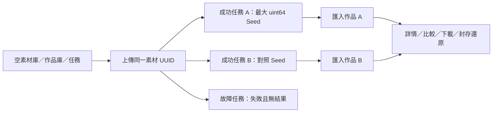

# 桌面介面驗收與證據

2026-10-29整理。此頁合併2026-10-27至29的原型與正式版驗收，**不是本次重新執行的測試結果**。每批的案例數、配置、資料身分、未測範圍分開記錄，不相加成一次全站驗收。現行規格見[PLAN](PLAN.md)，正式行為及必要差異見[整合紀錄](INTEGRATION-NOTES.md)。

核准[preview.html](preview.html) SHA256維持`f88076148aab2ff1471137f7b60a1be55c72c0d0f1219e52f981c462c9e76433`。本次只整理文件，HTML、PNG、JSON與程式／測試不改；原型示意、隔離mock、正式唯讀、真實GPU四類證據不可互換。axe A／AA無violations不等於完整讀屏、人工WCAG或實體觸控認證。

<a id="desktop-matrix"></a>

## 三尺寸分類、階段與支援矩陣

| 層級 | 本輪實際驗證 | 不代表的範圍 |
| --- | --- | --- |
| 桌面操作與樣式 | 1280×800、1440×900、1920×1080；模型 30 格、訓練 12 格、目的／架構 30 格，共 72 格 | 沒有宣稱每個文字區塊高度逐像素相同或全站人工無障礙認證 |
| 預覽回歸 | 五個創作圖示的 SVG 元素、路徑與尺寸；三尺寸既有主區塊幾何、側欄、設定／素材／作品／系統與創作空舞台檢查 | 幾何比對不是資料、任務或推論成功證據 |
| 後端支援契約 | 專用流程格式限制、FLUX 附加流程與模型 profile 共 23 項測試通過 | 模型登記、列出權重或通過契約不等於權重／相容性／品質已驗證 |
| 既有實機紀錄 | 連結下方各流程原紀錄，保留其硬體、版本與配置界線 | 本輪沒有重新執行 GPU 生成、trainer、權重下載或安裝 |

完整量測、每格版型與資料筆數、訓練資料集／匯出／合成 run 身分，以及預覽 hash 見 [機器可讀證據](desktop-acceptance-evidence.json)。測試程式見 [desktop-acceptance-matrix.spec.ts](../../frontend/tests/desktop-acceptance-matrix.spec.ts)。

### 一、模型五類 × 兩種版型

「通過」包括：分類切換、兩版型可見且資料名稱相同、正確的分類同步端點實際回覆成功、卡片三欄、左右位置／寬度與原預覽相符、卡片背景／框線／圓角相符，以及無整頁水平溢出。每類另測未保存版本文字在清單／卡片間保留、編輯時同步停用、取消後恢復同步。

| 子分類 | 版型 | 1280×800 | 1440×900 | 1920×1080 | 分類專用同步 |
| --- | --- | --- | --- | --- | --- |
| Checkpoint | 清單 | 通過 | 通過 | 通過 | `/api/models/sync` |
| Checkpoint | 卡片 | 通過 | 通過 | 通過 | 同上 |
| LoRA | 清單 | 通過 | 通過 | 通過 | `/api/loras/sync` |
| LoRA | 卡片 | 通過 | 通過 | 通過 | 同上 |
| 結構控制 | 清單 | 通過 | 通過 | 通過 | `/api/controlnets/sync` |
| 結構控制 | 卡片 | 通過 | 通過 | 通過 | 同上 |
| 元件 | 清單 | 通過 | 通過 | 通過 | `/api/reference-components/sync` |
| 元件 | 卡片 | 通過 | 通過 | 通過 | 同上 |
| FLUX 元件 | 清單 | 通過 | 通過 | 通過 | `/api/flux/components/sync` |
| FLUX 元件 | 卡片 | 通過 | 通過 | 通過 | 同上 |

使用真正隔離 FastAPI 清單與 metadata：Checkpoint、FLUX／LoRA 登記及結構／參考元件同步皆由合成引擎提供，不以瀏覽器把一份假清單回給五類。FLUX 保留 diffusion model、text encoders、VAE 分組，四個生成角色沒有被合成單一 Checkpoint。同步不下載或安裝權重。

原有來源、版本、授權、SHA256、檔案大小、架構及相容性／驗證工具保留在具名詳情或原登記表單。清單預設與深色方向不變。本輪驗收當次切換，不宣稱 N06 跨次偏好保存完成。

### 二、訓練四階段分別驗收

每個尺寸都透過檔案選擇器匯入一份新的三圖審查清單，捕捉該次匯入回覆的 UUID；階段 1、2 沿用同一資料集與修訂，階段 3、4 沿用該匯出 UUID 及明確標記的合成 run。沒有拿清單第一筆或另一組資料冒充目前表單。

| 階段 | 驗收操作／限制 | 1280×800 | 1440×900 | 1920×1080 |
| --- | --- | --- | --- | --- |
| 1 審查資料 | 三欄審查版型及階段列對照原預覽；只顯示待補預設勾選；標註與來源依據可編輯；1→2→1 保留未保存內容；取消切往控制階段保留原頁；保存並看下一張後修訂從 1 變 2 | 通過 | 通過 | 通過 |
| 2 匯出資料包 | 有待補或未保存時不可匯出；保存後真實後端出口檢查通過，明確匯出回覆 completed；核對資料集／修訂、bundle_verified、只匯出 1 張 train 與 training_started=false，本組的 validation／excluded 不加入訓練 | 通過 | 通過 | 通過 |
| 3 準備訓練 | 保留獨立環境檢查、已封存資料包、訓練 seed `4294967295`、總步數與保存間隔；3→4→3 保留設定；只有明確按準備才送出一次 prepare；使用階段 2 的匯出身分 | 通過 | 通過 | 通過 |
| 4 執行與產物 | 兩欄摘要與原預覽對照；讀取同一合成 run；0 步不當未知，5 步呈現實際進度，更新失敗保留快照，缺乏步數顯示未知並移除百分比；原 run／日誌／產物控制仍在下方 | 通過 | 通過 | 通過 |

前兩階段是實際審查保存與資料包匯出。本輪三圖樣本含 train、validation、excluded；test 最終評估圖不預覽／不匯出的既有規則保留，但未在本矩陣重新建立 test 樣本。準備／環境／run 回覆由頁面路由注入，以免啟動真實 trainer；回覆中的資料集與匯出身分來自前兩階段，配置也核對本次準備內容。三個尺寸的 `/start` 呼叫均為零，生成提交數亦不增加。合成狀態不認列為真正準備或完成訓練。

本輪沒有重新執行停止／新 run 續訓／產物安裝；其既有能力與驗收紀錄保留於 [訓練控制](../validation/training-workspace-20261025.md#t06-control)、[訓練產物](../validation/training-artifacts-20261025.md) 及原有測試。

### 三、五種創作目的 × Checkpoint／FLUX

表內「介面通過」指已測目的選取、實際路由／表單、所需控制、共用圖示與設定欄寬度、生成按鈕位於視窗內、無水平溢出及不自動提交；不將缺少素材、元件或 metadata 的流程寫成可立即生成。三種桌面尺寸均通過下列每一列。

| 目的 | Checkpoint 實際支援與本輪介面驗收 | FLUX 實際支援與本輪介面驗收 |
| --- | --- | --- |
| 文字創作 | SD 1.x／SDXL 一般 Checkpoint 工作台；`text2image`。介面通過 | Schnell 分離四元件 `flux1-schnell-text2image-v1`；獨立提示詞與草稿。介面通過 |
| 圖片重繪 | SD 1.x／SDXL 單張 VAE 圖生圖；`image2image`。來源、縮放與 Denoise 仍需明確設定。介面通過 | 獨立 `flux1-schnell-image2image-v1`；固定 512×512／4 steps／FP8 e4m3fn／CPU 編碼器，Denoise 必須小於 1；填 1 顯示欄位錯誤並阻擋生成。介面通過 |
| 局部修補 | 一般雙輸入／內側羽化 v2，以及 Fooocus SDXL 專用 v3，版本及對應元件分開。可切兩者；來源／遮罩不足時阻擋生成；保留遮罩編輯與生成結果切換。介面通過 | 沒有 FLUX 修補流程。點目的會進入獨立 Checkpoint 修補頁，須明確選相容模型與素材；沒有 FLUX 轉換或提交，原 FLUX 表單保留。未支援狀態通過 |
| 結構引導 | Canny 配對 SD 1.x／SDXL；Pose／Depth 是 SDXL 專用 v3，需匹配 ControlNet 及預處理器。三種可切換，結構預覽入口保留。介面通過 | 沒有 FLUX ControlNet／Pose／Depth 接入。目的導向獨立 Checkpoint 結構頁，不沿用 FLUX 權重。原 FLUX 表單保留；未支援狀態通過 |
| 風格參考 | SDXL 的 IP-Adapter Plus ViT-H 與匹配 CLIP Vision；畫風／角色外觀兩模式分開。兩模式可切，元件與來源不足仍阻擋。介面通過 | 沒有 FLUX Redux／IP-Adapter 畫風或角色流程。目的導向獨立 Checkpoint 參考頁；不把 VAE 圖生圖當成身份／畫風鎖定。原 FLUX 表單保留；未支援狀態通過 |

FLUX 的三個未支援格子是「確認沒有誤轉換／誤提交」，不是功能完成。從其獨立工作台返回時原提示詞仍保留，所有目的切換均不增加引擎提交。

FLUX 的 PVC model-only LoRA 是五目的以外的額外獨立流程，並非「風格參考」等同物；其固定版本、強度與配置限制、一般草稿拒收及不可與圖生圖混用仍保留。本輪後端契約測試涵蓋此界線，沒有重新認列 LoRA 推論品質。

#### 可保存與交換的格式界線

| 流程群 | 草稿／參數交換 | 其他保留能力 |
| --- | --- | --- |
| 一般 Checkpoint 文字／圖片重繪 | 沿用一般草稿與設定交換 | 精確 uint64 Seed、修訂、來源與完整 workflow |
| Schnell 純文生圖 | 獨立 FLUX 草稿與對應設定交換 | 四元件來源與當次環境，不降級成 Checkpoint |
| FLUX 附加 LoRA／VAE 圖生圖 | 獨立附加流程草稿；一般交換與比較方案不收不支援格式 | 原 UUID、完整參數、來源／元件快照與 workflow |
| 專用修補／結構／畫風角色 | 一般草稿、設定匯出／匯入與比較方案仍未開放專用格式 | 可載入完整已保存設定、下載完整 workflow；不捨棄雙輸入、羽化、控制參數或來源。workflow 本身不包含圖片 |

後端 `/api/reference-workflows/support` 是平台格式能力聲明，不是對當前引擎的檔案／節點即時認證。23 項本輪後端測試核對未支援格式會明確拒絕，未透過改 UI 認列為已接通。

#### 既有實機證據與本輪界線

- Checkpoint 主舞台的正式實圖沿用 [G01–G04 紀錄](INTEGRATION-NOTES.md#primary-flows) 中指定任務及配置；本輪沒有再生成。
- 修補、羽化與 Fooocus：見 [一般修補](../validation/checkpoint-inpaint-rtx3060.md)、[羽化修補](../validation/inpaint-feather-rtx3060.md)、[Fooocus 專用](../validation/fooocus-inpainting-20261023.md)。
- 結構與外觀參考：見 [結構紀錄](../validation/structure-reference-20261023.json)、[IP-Adapter 紀錄](../validation/reference-adapter-20261023.md)。不擴張成所有權重或角色一致性認證。
- Schnell：見 [純文生圖](../validation/flux-generation-20261025.md)、[獨立 LoRA／VAE 圖生圖](../validation/flux-extensions-20261025.md)。既有 GPU 驗收限固定四元件、RTX 3060、512×512／4 steps／FP8／CPU 編碼器等紀錄條件；一般文生圖參數可填其他合法值，不表示那些配置已經實測。

### 四、必要差異、原因與使用者可見行為

| 差異 | 原因 | 使用者可見行為／本輪處理 |
| --- | --- | --- |
| 五個創作目的圖示路徑曾不同 | 正式版殘留相似但不相同的線條、矩形與圓形座標，不是安全需求 | 已改回原預覽路徑；SVG 子元素與 22px 尺寸比對通過，未改預覽配合正式版 |
| 模型列的垂直起點與高度可能較預覽大 | 真正同步會回覆結果；參考元件有匹配說明，FLUX 另保留檔案類別分組及準備計畫 | 清單／卡片左緣、內容寬度與三欄樣式相符；同步成功訊息及來源說明會增加上方高度。量測保留實際 y 值，不宣稱所有子分類的起點／列高相同 |
| 模型不能一律提供「套用到創作」 | 原預覽部分按鈕只有示意；正式模型／元件沒有同一套安全套用語意 | Checkpoint 可明確帶入；LoRA、ControlNet、adapter 與 FLUX 分離元件保留各自來源、登記與相容性工具，不用無作用的套用按鈕冒充功能 |
| Checkpoint／FLUX 分成獨立工作台 | 權重角色、參數、草稿與工作流程不同，不能共用 Checkpoint loader 或默默改寫原設定 | 以架構入口與專用路由區分；切換目的不提交，原表單保留。未實作的三種 FLUX 專用目的不被包裝成支援 |
| 遮罩／條件預覽及結果各有切換入口 | 正式版需保留真實畫布、遮罩保存及同次條件圖；原型只有示意互動 | 編輯器與結果共存，沒有為了大圖刪除遮罩、結構預覽或歷史來源 |
| 訓練來源欄位比原型多 | 需保存標註審查、用途依據、分組與版本，並防止最終評估圖提早曝光 | 基本欄位先顯示，補充欄位在具名詳情；待補項目與修訂實際回報，不照抄原型的 9／12 |
| 訓練摘要不是 620／1000 的展示進度 | 原型明寫該進度與審查資料無關；正式版只能使用原 run 回報 | 顯示 0、真實回報步數或未知；失敗保留上次快照。準備與開始仍是兩個明確操作，原 UUID、續訓、資源與產物入口保留 |
| 專用流程未開放一般交換／比較格式 | 一般格式可能遺失來源、遮罩或控制參數 | 顯示能力限制或拒絕處理；仍可還原完整歷史設定與下載 workflow，不部分保存或默默降級 |
| 真實結果、硬體與容量讀值不同於原型 | 示意山巒、版本、GPU 與分類容量不是真實資料 | 讀實際結果與來源；未知保持未知。N07 分類容量、N05 任務抽屜及 N06 偏好保存仍按 [獨立待辦](BACKEND-CAPABILITIES-BACKLOG.md) 列管 |

這些差異都有具體資料或契約理由。其他漏項不能以「優化」概括帶過；本輪沒有改預覽、刪除正式能力或加入手機版。

### 五、可重跑方式與證據

在 `frontend`，完成正式建置後執行：

```powershell
npm.cmd run build -- --configLoader runner
npx.cmd playwright test tests/desktop-acceptance-matrix.spec.ts
npx.cmd playwright test tests/preview-alignment.spec.ts --grep "approved HTML geometry"
```

根目錄的後端支援檢查：

```powershell
.\.venv\Scripts\python.exe -m unittest backend.test_workflow_support backend.test_flux_extensions backend.test_model_profiles -q
```

本機實際使用新的臨時 `scripts/browser_fixture.py --port 18770`，透過忽略於 Git 的 runner 設定管理服務生命週期，避免此環境先前的自動清理等待。測試本身、正式前端與隔離後端相同，沒有連正式 DATA 或真正推論引擎；完成後停止臨時服務。

本輪不同瀏覽器案例共 13 項通過：新增 1 項圖示回歸、9 項分類／階段／架構矩陣，以及既有 3 項預覽幾何。九項矩陣內是 72 格驗收，沒有把每次重跑重複計數。另有 23 項後端支援測試、正式建置及範圍內格式／型別／CSS lint 通過。不是全套瀏覽器或全套後端回歸；建置仍有主 JS 超過 500 kB 的既有提醒。

所有格子的畫面與各案 JSON 保留在 `runtime/quality/matrix-accepted/1280`、`matrix-results-large`；補齊匯出報告核對後的三組訓練最終紀錄在 `matrix-training-final`，原三尺寸幾何在 `matrix-geometry-results`。這些執行產物不進 Git。以下代表畫面與合併證據已納入版本：

| 尺寸 | FLUX 元件卡片與分組 | 訓練審查 | 專用修補工作台 |
| --- | --- | --- | --- |
| 1280×800 | [畫面](desktop-models-1280.png) | [畫面](desktop-training-1280.png) | [畫面](desktop-purposes-1280.png) |
| 1440×900 | [畫面](desktop-models-1440.png) | [畫面](desktop-training-1440.png) | [畫面](desktop-purposes-1440.png) |
| 1920×1080 | [畫面](desktop-models-1920.png) | [畫面](desktop-training-1920.png) | [畫面](desktop-purposes-1920.png) |

同一來源圖片串接生成、作品匯入、詳情、比較、離線下載、封存還原及錯誤復原的逐步紀錄，另見 [上一輪連續流程驗收](ACCEPTANCE.md#isolated-journey)，不以本次頁面矩陣取代。

<a id="isolated-journey"></a>

## 同一隔離資料的連續旅程

每次從新的臨時 DATA 啟動，作品、素材與任務均為零。透過真正檔案選擇器上傳一張 64×64 PNG；同一素材 UUID 產生兩個成功任務，再明確匯入兩張作品。第二張是同來源的比較對照，沒有在別頁額外塞入示範作品。另從相同素材明確送出一個故障注入任務，驗證失敗狀態。



前端是目前正式建置，後端是實際 FastAPI／SQLite／圖片檔案及 ZIP 下載邏輯；只有引擎透過 `MockTransport` 提供合成圖與執行紀錄。保存失敗使用瀏覽器攔截 503；版本衝突則是真的經 API 更新 revision，再讓舊表單保存得到 409。這些操作不接正式 ComfyUI、不做 GPU 推論、不啟動訓練，也沒有改動正式 DATA。

可重跑測試：[isolated-journey.spec.ts](../../frontend/journey-tests/isolated-journey.spec.ts)。本次資料身分鏈、原圖與 ZIP 內容雜湊見 [journey-evidence.json](journey-evidence.json)；UUID 每次執行都不同，測試在同次執行內沿用它們，不硬編碼既有正式資料。

### 逐狀態結果

以下狀態全部已通過，收在 **1 個連續瀏覽器案例的 9 個具名步驟**，不當成九個獨立案例計數。

| 需求狀態 | 實際操作與判斷 |
| --- | --- |
| 無資料 | 後端清單實際回傳零筆；作品庫、素材庫提供各自初始引導，創作舞台顯示「準備下一張作品」，沒有預放完成圖片 |
| 有資料 | 檔案上傳後只有一張素材；詳情保存名稱後仍是同一 UUID 與原圖 hash；兩次明確生成後仍未自動新增作品 |
| 搜尋無結果 | 素材與作品分別輸入不存在名稱；出現各自無結果訊息，清除後回到原素材／兩張原作品，不重建資料 |
| 點圖詳情 | 素材圖片開啟詳情，確認尺寸與可編輯名稱；作品圖片以實際 64×64 原圖開啟，關閉後焦點回到同一卡片；卡片顯示日期與人工評分摘要 |
| 選取後操作 | 先出現已選 2 件操作列，畫面尚無比較區；按「並排比較」才換路由，保留來源任務 query。返回後離線下載 ZIP、批次封存與還原，選取與資料狀態正確更新 |
| 完成任務 | 兩次明確提交 → 從原任務讀取 completed → 舞台呈現原結果及實際尺寸；進作品庫選同一任務匯入。重複匯入不新增副本；作品的來源快照能對回素材 UUID |
| 錯誤／離線 | 未保存的引擎結果在離線時顯示錯誤，恢復後明確重新讀取才顯示；已保存結果可離線瀏覽與下載。引擎不可用時阻擋新提交，明確更新選項後恢復。第三筆任務由引擎故障紀錄回報 failed，結果 API 為 409，舞台不冒出成功圖片或自動重送 |
| 未保存編輯 | 素材編輯取消 Escape／網址切換後保留內容；503 保存不改後端資料。作品筆記取消關閉、503 與實際 409 衝突後都保留輸入，不能蓋過另一視窗的筆記；明確重新讀取後才能繼續保存 |
| 匯出與跨頁快取 | 從設定的引導回到原創作台，來源素材與 prompt 不變，原有交換控制可用。只有三次明確提交，查看、比較、匯出、離線重讀都沒有額外生成 |

原圖檢查不是只看縮圖：讀取原圖重算 SHA-256，比對 API 記錄；批次下載後由 Python `zipfile` 解開，逐檔檔名與內容雜湊必須等於這兩張作品。封存與還原後再確認原圖 hash、筆記、評分與最大 Seed 字串 `18446744073709551615` 不變。最終為 1 張來源素材、3 個明確提交的任務（2 成功、1 失敗）、2 張作品，瀏覽器 `pageerror` 為零。

### 驗收發現並修正的問題

先進入文字創作台，再從素材按「用於創作」時，`App.vue` 同時送出「切換圖片重繪」與「帶入素材」兩個請求。前一個先改掉 workflow，使表單變成 dirty；帶入素材的確認即使取消，工作流程仍已變動，來源卻沒有選入。這是實際狀態缺陷，不是 CSS 差異。

已移除這條帶入路徑的提前目的切換，交由原本的素材處理在確認後一起更新目的與來源。取消時保留原文字流程與 prompt；接受後才切換圖片重繪並選入指定素材，不自動生成。除了連續案例，再以 [asset-handoff.spec.ts](../../frontend/tests/asset-handoff.spec.ts) 最小回歸驗證取消／接受兩條路徑：修正前能重現取消後 workflow 錯變為 `image2image`；修正後通過。

### 執行方式與實際檢查

先在 `frontend` 完成正式建置，再執行：

```powershell
npm.cmd run build -- --configLoader runner
npx.cmd playwright test --config playwright.journey.config.ts
```

獨立設定預設使用本機 18769 埠、全新 `--empty` fixture、1440×900 桌面視窗、單 worker、零重試。一般套件仍使用原本的 `frontend/tests/`；本案例放在 `frontend/journey-tests/`，避免一般測試先新增資料後再聲稱驗證了空庫。它需要獨立執行，不含在一般全套檢查的成功宣告內。

本機 Playwright 自動清理測試伺服器會等待較久，因此實際綠燈執行沿用已記錄的外部 fixture 方法：手動啟動同一 `scripts/browser_fixture.py --port 18769 --empty`，用忽略於 Git 的 runner 設定關閉 `webServer` 自動管理，其餘沿用 `playwright.journey.config.ts`；完成後停止臨時服務。沒有改成連正式平台驗收，也沒有略過空庫斷言。

- 連續案例：1 項／9 步驟通過，保存畫面、資料鏈 JSON 與實際 ZIP。
- 受影響的獨立回歸：4 項通過，包括素材帶入取消／接受、模型與素材帶入、創作目的／精確 Seed／快取，以及設定匯出引導。
- 正式建置、範圍內格式／型別／CSS lint 與 `npm test` 契約檢查通過。建置仍有原有主 JS 超過 500 kB 提醒。
- 既有品質 runner 的 4 項後端測試通過，確認一般測試分批與失敗停止契約仍正常；未執行完整後端套件。
- 未執行完整瀏覽器套件，也未把本次 1440×900 操作驗收視為重新完成三種桌面尺寸的逐像素比對。沒有新增手機版範圍。

### 畫面證據

以下全是同次隔離資料流程，純色圖為合成引擎輸出，用於驗證圖片身分與操作，不代表生成品質。

| 畫面 | 證據 |
| --- | --- |
| 空舞台 | [截圖](journey-01-empty-stage.png) |
| 素材保存失敗保留輸入 | [截圖](journey-02a-asset-save-error.png) |
| 同一素材詳情 | [截圖](journey-02-asset-detail.png) |
| 完成任務與主舞台 | [截圖](journey-03-completed-stage.png) |
| 作品保存失敗保留筆記 | [截圖](journey-03a-artwork-save-error.png) |
| 已選操作列 | [截圖](journey-04-selection.png) |
| 明確進入作品比較 | [截圖](journey-05-comparison.png) |
| 已保存結果的離線舞台 | [截圖](journey-06-offline-saved-stage.png) |
| 同來源任務失敗 | [截圖](journey-07-failed-task.png) |

### 仍未交付的範圍

N07 分類容量、N05 全域任務抽屜、N06 跨次 UI 偏好保存仍是獨立未完成工作，見 [後續能力與驗收條件](BACKEND-CAPABILITIES-BACKLOG.md)。本輪沒有新增分類容量 API 或換色段冒充掃描結果。

本資料鏈驗收的是素材 → Checkpoint 圖片重繪 → 任務 → 作品／比較 → 設定匯出。模型五分類、其他創作流程、訓練四階段與實際部署仍依其各自的既有測試及後續驗收，不因這一條成功而一併宣告全平台全情境完成；尤其本輪沒有把訓練候選資料或合成進度冒充真實訓練成果。

後續三尺寸的模型五類、訓練四階段及創作目的／架構驗收已另列於 [桌面驗收矩陣](ACCEPTANCE.md#desktop-matrix)，不回寫為本資料鏈當時已驗過的項目。

<a id="delivery-batches"></a>

## 正式交付的各批檢查

以下是各批原始紀錄摘要，未宣稱完整舊版瀏覽器／後端全套通過；Vite各批仍有主JS超過500kB的既有提醒，數值隨版本由約527／556／576至600kB變化，不代表本次文件整理重新建置。

| 批次 | 當次實際檢查與界線 |
| --- | --- |
| 初次正式整合（2026-10-28） | 後端清單／API／容量／環境／路徑／容器等77項，桌面針對性瀏覽器32個不同案例；31項後補跑新三尺寸／階段／跨頁15與參考元件1，重跑不累加。12主要路由及訓練axe自動規則。未跑完整134舊瀏覽器；隔離mock、無GPU。Windows暫用手管fixture避免自動清理等待 |
| 直接HTML對照補正（2026-10-29） | 28個不同受影響瀏覽器（原桌面／狀態12、遮罩6、125圖訓練2、新對照／原始文件／結果／保存錯誤／瀑布流8）；後端實驗相關33。三尺寸主要幾何容差2–3px；保留原始文件7.0與7雜湊、精確Seed。隔離mock，沒有正式GPU；保留舊手機／觸控回歸不代表新增手機範圍 |
| 作品選取／N09 | 15個針對案例：新流程與批次6、原圖／參數／評分衝突2、跨頁1、焦點1、未保存歷史1、三尺寸及工作台4；axe操作列／比較；下載及匯入後端10。ZIP bytes、離線、零資料寫入、缺檔不送部分、UUID／100件／256MiB限制及暫存清理。保留既有兩個390px回歸，不宣告手機新版 |
| G01–G04主要流程 | 後端11（新結果讀取5、既有匯入6）：原引擎、不寫入、保存原圖離線／缺檔、非法路徑／索引、未完成、不可解碼、容量及離線。新增瀏覽器5與原回歸8；三尺寸／精確Seed／交接／參考回讀／遮罩及axe，來源結果切換不改PNG像素 |
| G05／G06／P01–P03 | 後端清單10：全部與符合分開、快照總數、筆數拒舊游標、四評分投影、分頁／唯讀／容量；新瀏覽器7與原回歸10：清單、空狀態、共同及專用預檢、兩架構交換、訓練未知／失敗、欄位在固定提交區上方。Node check:preflight驗精確Seed及不改輸入 |
| 分類／階段／架構矩陣 | 13個不同瀏覽器＝圖示1＋三尺寸模型／訓練／架構9＋既有幾何3；九矩陣內72格，後端支援23。詳細操作與JSON見上節，不認列GPU推論 |
| 訓練逐頁對齊 | 11個不同瀏覽器、三尺寸四階段12格；空資料／後端失敗／取消離開／保存失敗不切圖／125圖導覽／篩選／保留圖不曝光、同資料修訂與train-only匯出，再以原匯出身分測模擬prepare/run。含原UUID／停止／新run續訓／產物回歸、檢查列／收合欄位／固定基底／定位焦點／歷史與導覽／axe；沒有真正trainer或GPU |
| 模型逐分類對齊 | 6個不同瀏覽器：三尺寸五類兩版型30格＋空／無結果／歷史／離線／失敗保留／切類保留／axe＋Checkpoint交接＋參考元件真保存回讀。同步後重讀並量幾何，未隱藏成功訊息；20張對照截圖只GET。沒有改正式DATA、後端、權重或生成 |
| 素材詳情 | 四個瀏覽器：三尺寸及三圖比例、保存／封存還原、未保存關閉、修訂衝突、焦點／創作交接；建置／格式／型別／CSS通過。隔離截圖，正式山巒素材僅唯讀，未納使用者圖 |
| 作品卡片／詳情 | artwork-detail-ui五項：三尺寸等高／tooltip／tabs／捲動／axe、保存草稿／錯誤／封存還原／快速重開、原圖缺失參數；批次6項及原瀑布流／清單／筆記／未保存／衝突回歸、來源量測／資源／整數workflow與交換／鍵盤4項、完整同資料旅程。正式三尺寸僅唯讀，同列高差＜1px，無頁錯／寫API |
| 創作五目的對齊 | 25個不同受影響瀏覽器：三尺寸目的架構3、新對齊4、遮罩4、主要流程／預檢／交換/UI13、全旅程1。描述寬高與原型差≤3px；三尺寸×直橫方9格遮罩／原圖座標與寬高差＜1px。工具焦點、來源／值保留、CPU503、Pose/Depth不計算、欄位定位及離線失敗；全部npm test／建置／格式／型別／CSS通過，正式僅讀填表0生成0保存 |
| 創作操作區後續美化 | 另16個受影響案例：三尺寸矩陣、9遮罩幾何、實際縮放筆畫／PNG像素、無效PNG／保存失敗、指標鎖定／取消、工具焦點／參數／預檢、完成離線結果重試、undo/redo。縮放像素測試保留原斷言與誤差，三尺寸舞台不修改；建置、format、lint、全部npm test通過，沒有正式寫入／GPU |

上述各批皆按其原紀錄跑範圍內格式、型別／CSS lint、正式build與相關Node契約；部分亦有Python格式/lint。不是所有批次都跑完整npm或後端／瀏覽器全套。本次整理沒有重跑產品檢查。

<a id="formal-evidence"></a>

## 正式環境的讀取與實圖證據

先確認原引擎沒有排隊或生成工作、平台沒有活躍任務或訓練 run，再重新啟動平台後端載入結果 API；ComfyUI 保持執行。

| 項目 | 實際結果 |
| --- | --- |
| 生成任務 | `09643da5-a89e-4196-8d52-399df3d4a751`，已完成 |
| 配置 | RTX 3060、Animagine XL 4.0 Opt、1024 × 1024、20 steps、Euler／normal、CFG 7、Seed 字串 `20261029` |
| 引擎原圖 | `ModelAtelier_00061_.png`，山巒與小徑插畫 |
| 正式主舞台 | 讀到該任務及 1024 × 1024 原圖；清楚顯示尚未匯入作品庫，瀏覽器無未處理頁面錯誤 |
| 作品庫副作用 | 預覽前後皆為 4 張，沒有自動匯入 |
| 正式素材詳情 | 以這張測試圖新增 `[UI驗證] 山巒參考圖`，ID `e4a0b880-e437-4b55-a198-428df2abb12f`；詳情圖像與尺寸正確 |
| 素材帶入 | 從詳情「用於創作」進入風格參考，正確帶入上述素材 ID；操作前後任務數均為 7，沒有自動生成 |

此一測試任務、引擎輸出及新增參考素材保留供使用者查看。沒有刪除或修改既有作品；測試圖尚未加入作品庫。

### 第二批唯讀確認

確認沒有活躍任務、排隊或訓練 run 後重新啟動平台後端，讓清單載入總數與評分投影。使用正式圖片查看作品庫、搜尋無結果並清除條件，以及設定匯出引導。作品前後均為 4 張、任務前後均為 7 件；4 張卡皆有日期，清單 `all_total` 為 4，沒有未處理的瀏覽器頁面錯誤。

本批沒有提交新生成或訓練，也沒有修改正式作品筆記／評分。訓練進度、版本衝突及錯誤情境使用隔離測試資料；不把測試進度當成正式訓練成果。

後續模型、訓練、創作與作品詳情改版使用新的隔離DATA／模擬引擎；正式圖片只作唯讀視覺檢查，未將使用者作品推送到版本庫。正式唯讀畫面和數值留於忽略的runtime/quality，不把合成run當真正訓練或把CPU預覽當原引擎條件圖。

<a id="prototype-history"></a>

## 原型階段歷史檢查（2026-10-27至28）

這些只驗獨立HTML／記憶體示意，沒有正式API、檔案系統、生成或訓練。早期手機尺寸不是本輪新交付目標；之後桌面規格優先。

| 批次 | 當時範圍、結果與限制 |
| --- | --- |
| v1／v2／v3 | 各8頁×4情境×1440/768/390共96組，無整頁橫溢／JS例外；各正常頁axe A/AA無violations，裝飾/SVG對比有incomplete，不宣稱完整讀屏觸控。v1修工作台／訓練對比與短側欄，v2查五系統組／六目錄／模型路徑／來源彈窗／診斷識別；v3查VAE缺件僅阻FLUX、uint64/steps邊界、版型保選、比較封存、素材帶入、遮罩保留及工具視窗Escape |
| SVG／創作共用精對齊 | 1440×1000八導覽SVG標記／寬高／線寬／內距／字體位置相同；390無整頁橫溢。五目的SVG、四尺寸形狀與控制／畫布樣式直接比較，96組回歸；訓練選取改對比底色 |
| 作品／實驗／素材 | 作品各控件精對齊，1440/768/390/2560固定／瀑布流不溢；選取收藏封存與重整預設測過。實驗三寬×四情境、20px組名與steps單位；素材三寬×四情境、用途＋搜尋、清空／詳情／帶入。三頁axe無violations，無JS錯；只是原型 |
| 模型／訓練／設定 | 模型5類×2版×4情境×3寬120格；訓練4階段×4情境×3寬48格；設定5類×4情境×3寬60格，無整頁橫溢／JS，axe自動無violations。保留原型編輯草稿、缺件、預設、保存下一張、連線／路徑／診斷輸入；不代表真同步／trainer |
| 修補與作品詳情 | 筆畫／擦除減少像素、反相／清除／工具跨目的保留，筆記收藏、原尺寸載入、來源折疊、封存／Escape；三寬四情境及窄彈窗不溢，axe無violations |
| 系統主卡早期合併 | 1280×800/1440×900/1920×1080×4情境12組，核可用／已用／總量唯一位置、未知／離線、完整資訊鍵盤、C/D與六目錄、到模型路徑；收合展開axe。後由最新四分頁HTML取代，不把早期布局當現行規格 |
| 評審修正 | 8頁×4情境×3桌面96組無溢／重複h1／高度差／JS；另12組離線缺件高度扣除，生成與任務可見。100次指標移動無快照、放開1筆、最多21狀態＝20復原、像素undo/redo一致且文字CtrlZ隔離；1440×1000/1920×1600/1280×1500直式圖與canvas四邊差0，實測高1236.125及991.265625px超650。模型不暗換、連續自訂尺寸、排序分頁跨頁6選取、審查9→10、tabs／history測過；六頁＋遮罩axe無violation但有人工incomplete |
| 最新系統參考 | 4分頁×5情境×1280×800/1440×1000/1920×1080共60組，無溢／重複頁名／JS，1120共左緣57px/18px頂欄；原SVG／資料夾18/1.8及36按鈕。固定tabs鍵盤／焦點／摘要跳轉不改hash、六目錄／未知停用／安裝空／低容量合計；正常需注意8組axe無violations，其他7頁×2桌面14組保62px且無情境殘留 |

<a id="page-evidence"></a>

## 逐頁畫面與機器可讀證據

保留原圖／JSON路徑，供測試產圖與既有引用使用。原型圖不代表正式功能，fixture圖不代表生成品質；下列素材皆按原報告標示來源。

### 模型五類

下列均為 1440×900，正式畫面使用隔離測試目錄與模擬引擎的實際清單 API；不是正式使用者資料。檔名、筆數及未知欄位不同於原型，沒有複製示意模型到正式資料庫。

| 分類 | 原預覽清單 | 正式清單 | 原預覽卡片 | 正式卡片 |
| --- | --- | --- | --- | --- |
| Checkpoint | [原清單](models-reference-checkpoint-list.png) | [正式清單](models-platform-checkpoint-list.png) | [原卡片](models-reference-checkpoint-cards.png) | [正式卡片](models-platform-checkpoint-cards.png) |
| LoRA | [原清單](models-reference-lora-list.png) | [正式清單](models-platform-lora-list.png) | [原卡片](models-reference-lora-cards.png) | [正式卡片](models-platform-lora-cards.png) |
| 結構控制 | [原清單](models-reference-control-list.png) | [正式清單](models-platform-control-list.png) | [原卡片](models-reference-control-cards.png) | [正式卡片](models-platform-control-cards.png) |
| 元件 | [原清單](models-reference-reference-list.png) | [正式清單](models-platform-reference-list.png) | [原卡片](models-reference-reference-cards.png) | [正式卡片](models-platform-reference-cards.png) |
| FLUX 元件 | [原清單](models-reference-flux-list.png) | [正式清單](models-platform-flux-list.png) | [原卡片](models-reference-flux-cards.png) | [正式卡片](models-platform-flux-cards.png) |

### 訓練四階段

以下為 1440×900。正式畫面使用隔離資料，不是使用者的正式訓練資料；內容與原型示意數字不同。

| 階段 | 原 preview | 調整後正式介面 |
| --- | --- | --- |
| 審查資料 | [原畫面](training-reference-stage-1.png) | [正式畫面](training-platform-stage-1.png) |
| 匯出資料包 | [原畫面](training-reference-stage-2.png) | [正式畫面](training-platform-stage-2.png) |
| 準備訓練 | [原畫面](training-reference-stage-3.png) | [正式畫面](training-platform-stage-3.png) |
| 執行與產物 | [原畫面](training-reference-stage-4.png) | [正式畫面](training-platform-stage-4.png) |

審查截圖使用同一資料集的原始修訂 1；匯出截圖為保存後修訂 2，準備頁使用該修訂的實際資料包。執行截圖為同一資料身分綁定的明確標記模擬 run，不認列為真正訓練。截圖擷取沒有提交或保存資料。

### 創作五目的

下列為 1440×900，正式介面使用隔離測試資料。單色方塊是測試 PNG，並非生成品質示範；結果圖與目前表單可以屬於不同任務，畫面保留原任務身分。

| 目的 | 原 preview | 調整後正式介面 |
| --- | --- | --- |
| 文字創作 | [原畫面](studio-reference-text.png) | [正式介面](studio-platform-text-fixture.png) |
| 圖片重繪 | [原畫面](studio-reference-image.png) | [正式介面](studio-platform-image-fixture.png) |
| 局部修補 | [原畫面](studio-reference-inpaint.png) | [正式介面](studio-platform-inpaint-fixture.png) |
| 結構引導 | [原畫面](studio-reference-control.png) | [正式介面](studio-platform-control-fixture.png) |
| 風格參考 | [原畫面](studio-reference-reference.png) | [正式介面](studio-platform-reference-fixture.png) |

既有 [完成結果](platform-stage-result-fixture.png) 與 [欄位預檢](platform-preflight-fields-fixture.png) 截圖亦已更新。正式平台另以現有模型與素材逐目的檢查，截圖僅留在本機忽略的 `runtime/quality/`，沒有將使用者素材加入版本庫。


[模型幾何／筆數證據](models-preview-evidence.json)、[訓練資料／幾何證據](training-preview-evidence.json)、[創作目的矩陣](studio-preview-evidence.json)、[後續操作區](studio-controls-evidence.json)。

### 第一輪及流程補齊代表畫面

- [創作工作台](platform-studio-fixture.png)
- [作品庫](platform-gallery-fixture.png)
- [作品詳情](platform-artwork-detail-fixture.png)
- [作品選取操作列](platform-gallery-selection-fixture.png)
- [獨立作品比較](platform-artwork-comparison-fixture.png)
- [參考素材](platform-assets-fixture.png)
- [模型清單](platform-models-fixture.png)
- [模型卡片](platform-model-cards-fixture.png)
- [實驗比較，含模擬引擎實際保存的測試結果](platform-experiments-fixture.png)
- [訓練審查](platform-training-fixture.png)
- [設定](platform-settings-fixture.png)
- [系統資訊](platform-system-fixture.png)
- [局部修補](platform-inpaint-fixture.png)
- [正式環境主舞台實圖](platform-stage-result-real.png)
- [正式環境素材詳情實圖](platform-asset-detail-real.png)
- [隔離環境模型分類卡片](platform-model-categories-fixture.png)
- [隔離環境素材詳情及操作](platform-asset-detail-fixture.png)
- [正式作品庫資訊](platform-gallery-information-real.png)
- [正式設定匯出引導](platform-settings-export-real.png)
- [欄位預檢與定位](platform-preflight-fields-fixture.png)
- [訓練執行摘要](platform-training-summary-fixture.png)
- [更新失敗保留快照](platform-training-summary-warning-fixture.png)


<a id="rerun"></a>

## 補充重跑入口與限制

先建置正式前端，既有Playwright設定會啟隔離fixture。Windows曾遇到自動清理等待，原實跑暫採手管`browser_fixture.py`和Git忽略runner，webServer設undefined；不改成連正式DATA，也不略過空庫斷言。歷史使用埠包括18769（空旅程）、18770（矩陣）、18772（模型／訓練）、18774（創作）、18775 --empty（後續旅程），都不是常駐產品服務。

```powershell
cd frontend
npm.cmd run build -- --configLoader runner
npx.cmd playwright test tests/desktop-acceptance-matrix.spec.ts
npx.cmd playwright test tests/studio-preview-alignment.spec.ts tests/mask-editor.spec.ts tests/ui-redesign.spec.ts tests/primary-gaps.spec.ts tests/secondary-gaps.spec.ts
npx.cmd playwright test tests/artwork-detail-ui.spec.ts
npx.cmd playwright test --config playwright.journey.config.ts
```

旅程須獨立空DATA；一般tests不能先填資料再冒充驗過空庫。模型原批亦選preview-alignment/ui-redesign的model五類／handoff／reference metadata；訓練原批選training-control、training-review-navigation、preview-alignment、secondary-gaps的四階段／explicit training／saved review issues／populated review／save-and-next／summary／empty stages。精確批次案例數見上表，列出指令不是新執行宣告。

正式版保留舊390px作品整理測試：曾在原搜尋／篩選列不換行及固定寬度的整頁橫向溢出斷言失敗，未刪除或放寬；本輪沒有重做手機版。Vite大包提示也仍存在。N05／N06／N07沒有因此完成；真實GPU配置／權重／來源與品質限其各自硬體驗收，不能以mock旅程或原型截圖取代。
