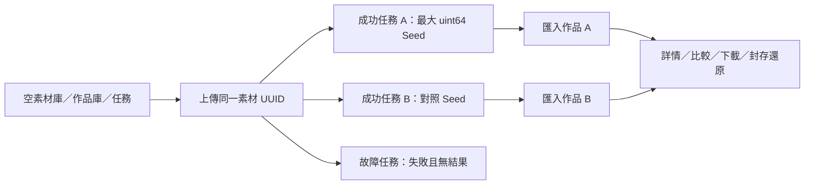

# 同組隔離資料逐流程驗收

日期：2026-10-29。這是跨頁的狀態與操作驗收；原始視覺基準仍是 `preview.html`，沒有為了測試通過修改預覽。

## 資料與範圍

每次從新的臨時 DATA 啟動，作品、素材與任務均為零。透過真正檔案選擇器上傳一張 64×64 PNG；同一素材 UUID 產生兩個成功任務，再明確匯入兩張作品。第二張是同來源的比較對照，沒有在別頁額外塞入示範作品。另從相同素材明確送出一個故障注入任務，驗證失敗狀態。



前端是目前正式建置，後端是實際 FastAPI／SQLite／圖片檔案及 ZIP 下載邏輯；只有引擎透過 `MockTransport` 提供合成圖與執行紀錄。保存失敗使用瀏覽器攔截 503；版本衝突則是真的經 API 更新 revision，再讓舊表單保存得到 409。這些操作不接正式 ComfyUI、不做 GPU 推論、不啟動訓練，也沒有改動正式 DATA。

可重跑測試：[isolated-journey.spec.ts](../../frontend/journey-tests/isolated-journey.spec.ts)。本次資料身分鏈、原圖與 ZIP 內容雜湊見 [journey-evidence.json](journey-evidence.json)；UUID 每次執行都不同，測試在同次執行內沿用它們，不硬編碼既有正式資料。

## 逐狀態結果

以下狀態全部已通過，收在 **1 個連續瀏覽器案例的 9 個具名步驟**，不當成九個獨立案例計數。

| 需求狀態 | 實際操作與判斷 |
| --- | --- |
| 無資料 | 後端清單實際回傳零筆；作品庫、素材庫提供各自初始引導，創作舞台顯示「準備下一張作品」，沒有預放完成圖片 |
| 有資料 | 檔案上傳後只有一張素材；詳情保存名稱後仍是同一 UUID 與原圖 hash；兩次明確生成後仍未自動新增作品 |
| 搜尋無結果 | 素材與作品分別輸入不存在名稱；出現各自無結果訊息，清除後回到原素材／兩張原作品，不重建資料 |
| 點圖詳情 | 素材圖片開啟詳情，確認尺寸與可編輯名稱；作品圖片以實際 64×64 原圖開啟，關閉後焦點回到同一卡片；卡片顯示日期與人工評分摘要 |
| 選取後操作 | 先出現已選 2 件操作列，畫面尚無比較區；按「並排比較」才換路由，保留來源任務 query。返回後離線下載 ZIP、批次封存與還原，選取與資料狀態正確更新 |
| 完成任務 | 兩次明確提交 → 從原任務讀取 completed → 舞台呈現原結果及實際尺寸；進作品庫選同一任務匯入。重複匯入不新增副本；作品的來源快照能對回素材 UUID |
| 錯誤／離線 | 未保存的引擎結果在離線時顯示錯誤，恢復後明確重新讀取才顯示；已保存結果可離線瀏覽與下載。引擎不可用時阻擋新提交，明確更新選項後恢復。第三筆任務由引擎故障紀錄回報 failed，結果 API 為 409，舞台不冒出成功圖片或自動重送 |
| 未保存編輯 | 素材編輯取消 Escape／網址切換後保留內容；503 保存不改後端資料。作品筆記取消關閉、503 與實際 409 衝突後都保留輸入，不能蓋過另一視窗的筆記；明確重新讀取後才能繼續保存 |
| 匯出與跨頁快取 | 從設定的引導回到原創作台，來源素材與 prompt 不變，原有交換控制可用。只有三次明確提交，查看、比較、匯出、離線重讀都沒有額外生成 |

原圖檢查不是只看縮圖：讀取原圖重算 SHA-256，比對 API 記錄；批次下載後由 Python `zipfile` 解開，逐檔檔名與內容雜湊必須等於這兩張作品。封存與還原後再確認原圖 hash、筆記、評分與最大 Seed 字串 `18446744073709551615` 不變。最終為 1 張來源素材、3 個明確提交的任務（2 成功、1 失敗）、2 張作品，瀏覽器 `pageerror` 為零。

## 驗收發現並修正的問題

先進入文字創作台，再從素材按「用於創作」時，`App.vue` 同時送出「切換圖片重繪」與「帶入素材」兩個請求。前一個先改掉 workflow，使表單變成 dirty；帶入素材的確認即使取消，工作流程仍已變動，來源卻沒有選入。這是實際狀態缺陷，不是 CSS 差異。

已移除這條帶入路徑的提前目的切換，交由原本的素材處理在確認後一起更新目的與來源。取消時保留原文字流程與 prompt；接受後才切換圖片重繪並選入指定素材，不自動生成。除了連續案例，再以 [asset-handoff.spec.ts](../../frontend/tests/asset-handoff.spec.ts) 最小回歸驗證取消／接受兩條路徑：修正前能重現取消後 workflow 錯變為 `image2image`；修正後通過。

## 執行方式與實際檢查

先在 `frontend` 完成正式建置，再執行：

```powershell
npm.cmd run build -- --configLoader runner
npx.cmd playwright test --config playwright.journey.config.ts
```

獨立設定預設使用本機 18769 埠、全新 `--empty` fixture、1440×900 桌面視窗、單 worker、零重試。一般套件仍使用原本的 `frontend/tests/`；本案例放在 `frontend/journey-tests/`，避免一般測試先新增資料後再聲稱驗證了空庫。它需要獨立執行，不含在一般全套檢查的成功宣告內。

本機 Playwright 自動清理測試伺服器會等待較久，因此實際綠燈執行沿用已記錄的外部 fixture 方法：手動啟動同一 `scripts/browser_fixture.py --port 18769 --empty`，用忽略於 Git 的 runner 設定關閉 `webServer` 自動管理，其餘沿用 `playwright.journey.config.ts`；完成後停止臨時服務。沒有改成連正式平台驗收，也沒有略過空庫斷言。

- 連續案例：1 項／9 步驟通過，保存畫面、資料鏈 JSON 與實際 ZIP。
- 受影響的獨立回歸：4 項通過，包括素材帶入取消／接受、模型與素材帶入、創作目的／精確 Seed／快取，以及設定匯出引導。
- 正式建置、範圍內格式／型別／CSS lint 與 `npm test` 契約檢查通過。建置仍有原有主 JS 超過 500 kB 提醒。
- 既有品質 runner 的 4 項後端測試通過，確認一般測試分批與失敗停止契約仍正常；未執行完整後端套件。
- 未執行完整瀏覽器套件，也未把本次 1440×900 操作驗收視為重新完成三種桌面尺寸的逐像素比對。沒有新增手機版範圍。

## 畫面證據

以下全是同次隔離資料流程，純色圖為合成引擎輸出，用於驗證圖片身分與操作，不代表生成品質。

| 畫面 | 證據 |
| --- | --- |
| 空舞台 | [截圖](journey-01-empty-stage.png) |
| 素材保存失敗保留輸入 | [截圖](journey-02a-asset-save-error.png) |
| 同一素材詳情 | [截圖](journey-02-asset-detail.png) |
| 完成任務與主舞台 | [截圖](journey-03-completed-stage.png) |
| 作品保存失敗保留筆記 | [截圖](journey-03a-artwork-save-error.png) |
| 已選操作列 | [截圖](journey-04-selection.png) |
| 明確進入作品比較 | [截圖](journey-05-comparison.png) |
| 已保存結果的離線舞台 | [截圖](journey-06-offline-saved-stage.png) |
| 同來源任務失敗 | [截圖](journey-07-failed-task.png) |

## 仍未交付的範圍

N07 分類容量、N05 全域任務抽屜、N06 跨次 UI 偏好保存仍是獨立未完成工作，見 [後續能力與驗收條件](BACKEND-CAPABILITIES-BACKLOG.md)。本輪沒有新增分類容量 API 或換色段冒充掃描結果。

本資料鏈驗收的是素材 → Checkpoint 圖片重繪 → 任務 → 作品／比較 → 設定匯出。模型五分類、其他創作流程、訓練四階段與實際部署仍依其各自的既有測試及後續驗收，不因這一條成功而一併宣告全平台全情境完成；尤其本輪沒有把訓練候選資料或合成進度冒充真實訓練成果。
